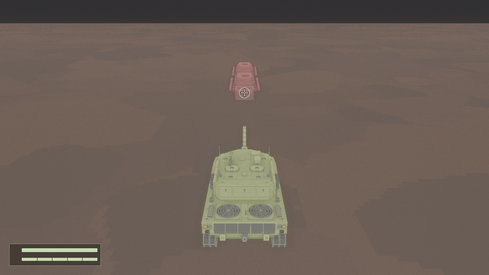
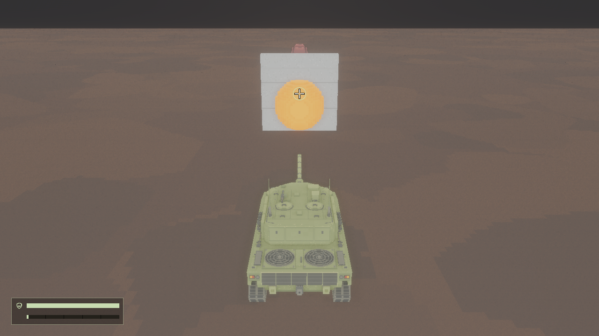
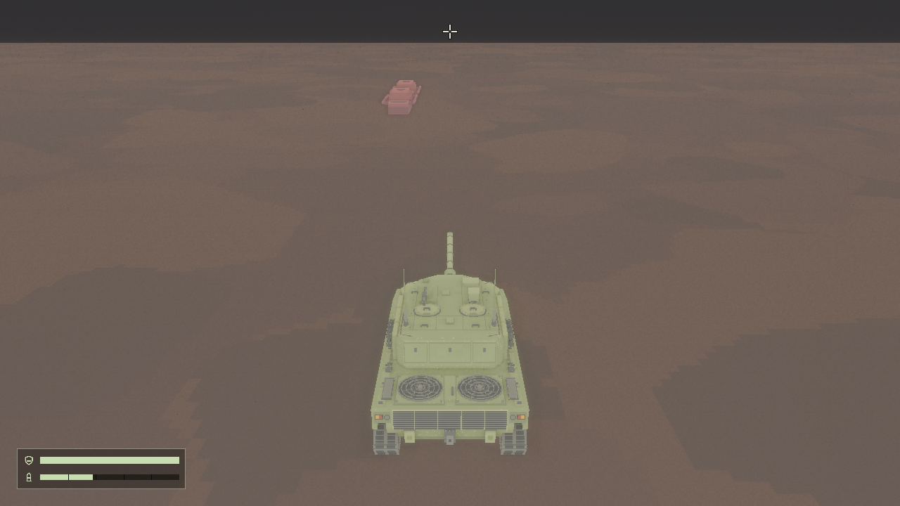

# aiming 02：准星设计稿与实现验收

日期：2026-11-02。范围：实际弹体路径预测与画面内准星；不修改相机跟随方式、模型、弹药配置或目标碰撞规则。

## 实际游戏画面设计稿

以下为现有离屏入口的真实游戏相机输出，未使用临时近景机位或概念图。20×20px 留空十字采用米白色、2px 线宽、4×4px 中央空隙及每段 1px 暖黑外描边；28px 薄荷空心圆仅表达预测接触，圆线宽 1px。保留这些默认尺寸。

命中敌车，准星位于弹体与车体碰撞外形的接触处：

混凝土阻挡后方敌人；装填及上一发爆炸仍在显示，圆不代表装填完成：

射击方向没有有效目标，只显示方向十字；远端点不是地面命中点：

检查结论：默认尺寸下形状可辨、中央留空，暖黑描边支撑米白线条；圆和十字共同区分命中与方向。敌车与混凝土的碰撞形状仍是现有简化外形，因此不保证逐体素表面吻合。此为实现者画面检查记录，用户最终美术认可未获得。

## 技术验收

新增 `cargo run -- --offscreen-test aiming --output <新目录>`，复用固定种子、1280×720、1/60s、120帧预热、实际场景和 GPU 截图入口；布靶阶段使用实际敌人配置与模型及真实混凝土凸体，固定目标以便预测与真实射击可比较。初始常规场景断言保留；确定性布靶后不再要求随机场景的十辆敌人数，仅等待渲染就绪。

13组用例包括近距离视差、上仰、下俯、侧向和后向、前后目标、混凝土遮挡、弹体擦边但中心射线未中、起始重叠、超射程、场地外不可达、无目标，以及场地外仍处于最后一个有效步长内的目标。预测与真实首碰对象一致，接触点差≤0.01m；画面内最终 UI 布局中心与相机投影差≤2px。已知迎弹面另用独立几何检查。装填中真实 W 输入仍更新准星，已毁目标不再保留，炮管缺失即时隐藏，统一退出清理无残留。

最终重编译曾遇到一次 `rustc` 访问冲突退出（0xc0000005）；只在命令行关闭增量编译后重建和离屏通过，未改动 Cargo 配置，尚未独立确认编译器崩溃根因。

本机报告：[aiming 离屏报告](../references/aiming-02-2026-11-02/report.txt)。实际设备：NVIDIA GeForce RTX 4060 / Vulkan，退出码0。首次边界布靶错误、一次布靶后的就绪等待错误，以及评审发现的f32边界步数和描边侵入中央空隙问题已修正，失败证据保留于本机 `.scratch/aiming/`，不作为通过证据。

逻辑回归覆盖射速、冷却、多发独立性、扫掠、射程和边界清理；额外检查方向终点边界及近面、后方、四边之外、NaN、未就绪相机的投影隐藏。根目录 `cargo check` 通过；完整 `cargo test --config build.incremental=false` 通过（129个单元测试、9个集成测试）。`combat`、`articulation`、`hud` 离屏回归均退出0，报告通过，关键帧已读取。

## 限制与后续

预测假定目标静止，并按当前模拟帧的步长推算场地清理终点；未来帧时长变化或目标移动可能改变实际结果。边界终点逐帧使用与真实弹丸相同的f32运算；最多推算一万帧，极小时间步长无法在预算内确定终点时隐藏准星。截图等待为零时间更新，保留最近有效模拟步长。

本票只预测敌人和混凝土；地面与围墙仍不拦弹。起始重叠没有唯一接触位置，采用有限的零距离出生中心作为锚点。画面外暂时隐藏，03补边缘提示和其它视口/缩放边界，04补完整集成验收。未启动可见窗口，未做其它GPU、Linux或其它分辨率的实际画面验收。
