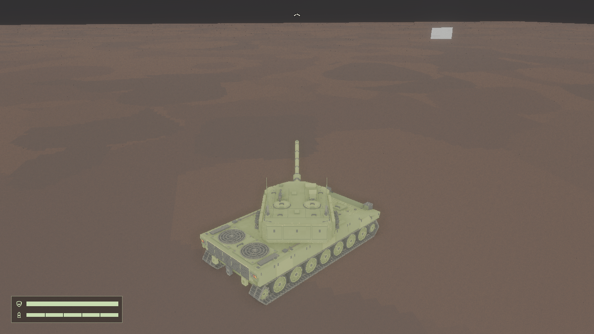
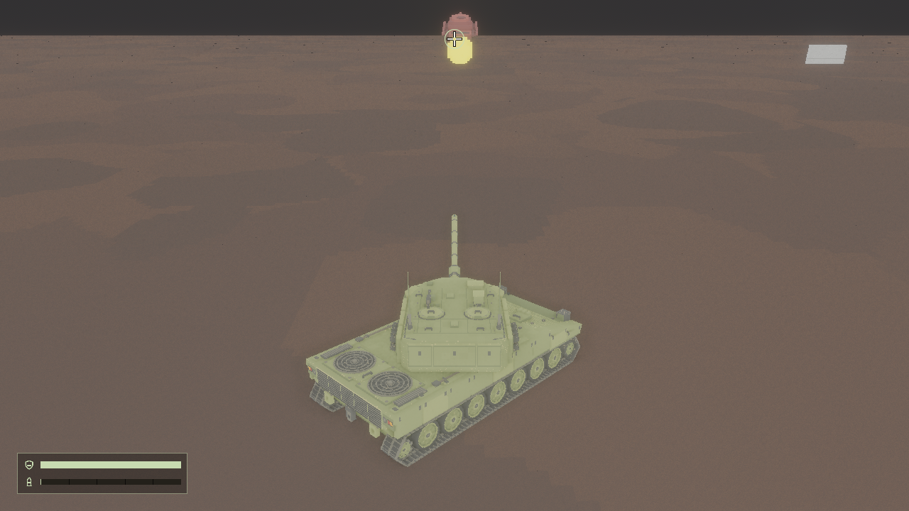
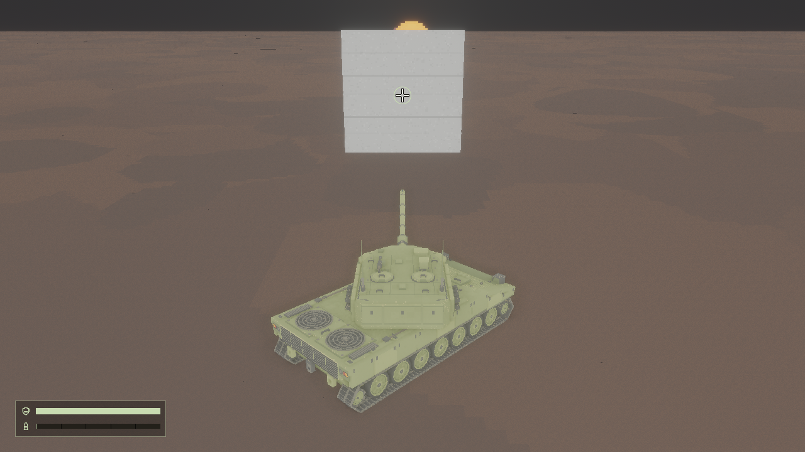
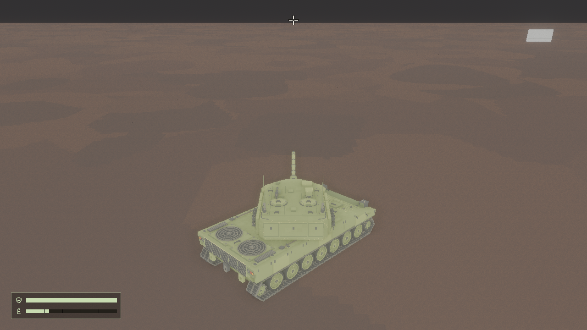
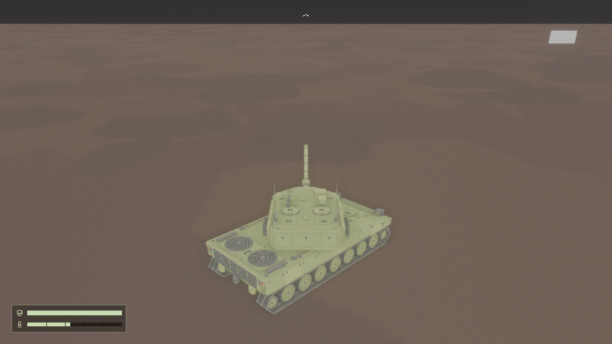
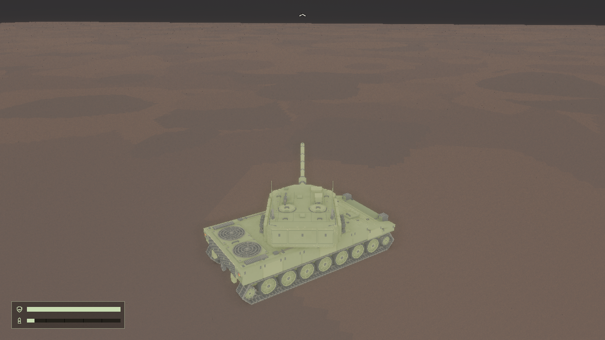
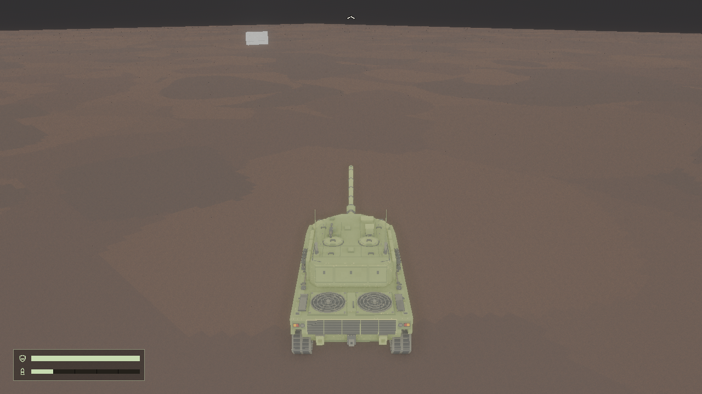
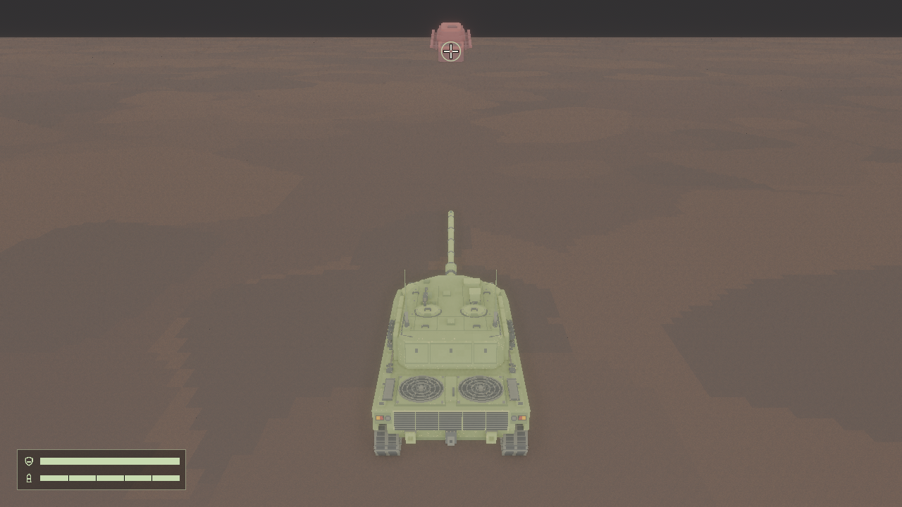

# aiming 04：完整瞄准体验集成验收

日期：2026-11-02。范围：真实对局链路下方向键驾驶、WASD 调炮与空格开火的组合一致性、角度回绕、退出重进生命周期与全部关键画面验收；不修改碰撞、驾驶或弹药玩法参数。

## 实际游戏画面设计稿

以下为新增 `integrated` 离屏预设的真实跟随相机输出（1280×720，RTX 4060 / Vulkan），全程使用玩家实际机位，未使用临时近景相机。

驾驶+转车+调炮组合帧（帧150，偏航45°、俯仰9°），指向投影位于画面上方之外，钳制边缘箭头指示方向，画面内无十字、无命中圆：

组合运动停止后按静止炮口布置前后双靶并开火（帧176），命中圆锚定前靶接触处、爆炸显示，后靶存活未被波及，装填条消耗：

混凝土墩搬到弹道15米处近距离遮挡开火（帧195），首碰为混凝土墩且与预测一致，命中圆在墩正面：

压回水平后的无命中方向（帧270），只显示纯十字、无命中圆，预测目标为空：

抬炮使投影出画面（帧330），上缘钳制箭头；随后装填冷却中继续调炮（帧360），准星实时更新且未产生第二发：

偏航跨越360°回绕前后（帧397→398，359.75°→0.25°），机位连续无跳变：

Esc 真实退出并经菜单重进后的全新对局，脚本目标与混凝土位移无残留，默认靶车命中圆正常：

检查结论：暗地面与亮天空背景下米白准星、边缘箭头与命中圆均可辨；十字中央留空、与命中圆和箭头形状区分明确；遮挡与命中构图符合预期。此为实现者画面检查记录，用户最终视觉认可未取得。

## 技术验收

新增 `cargo run -- --offscreen-test integrated --output <新目录>`（src/validation/scenarios/integrated.rs），复用实际场景、资源、物理与渲染配置，固定种子42、1280×720、1/60s、120帧预热。组合脚本：1-60 直行；61-150 驾驶+转车+调炮同时按下；171 组合停止后按实际静止炮口布置前后双靶、174 开火；191 搬回混凝土墩到弹道15米、194 遮挡开火；211 清空目标与墩；211-270 KeyS 压回水平；271-330 KeyW 抬炮；336 装填冷却中开火并继续调炮；397 直接设定偏航359.75°、398 按 KeyA 跨越回绕；400 后以注入帧 501/503/505 走真实 Esc 退出、菜单操作与 Enter 重进链路。

每帧一致性断言：相机机位与 `camera_transform` 公式偏差≤0.001米；相机旋转与公式逐分量四元数差≤1e-6（glam `angle_between` 在128°附近会把 dot 的 1 ulp 舍入放大成约7e-4 rad 假角差，故不用角距离断言），证明炮管俯仰不改变相机姿态；炮口世界方向与姿态公式差≤1e-4；HUD 最终布局（`check_layout`）与预测同帧复算；在途弹丸≤1。命中对照：真实首碰对象与开火帧预测一致、接触点差≤0.01米；前靶命中后后靶存活，且帧180断言前靶已销毁、预测即时切换到后靶（目标销毁后更新）；遮挡首碰为混凝土墩；帧270预测目标为空且十字显示、无命中圆；帧330边缘箭头显示；帧360装填中准星实时更新且无第二发；帧398回绕后机位偏移<0.2米连续；Esc 退出后对局实体、准星与预测清零；重进后全新对局预测、HUD 与相机一致。

关于「无效投影隐藏」：炮塔跟随相机恒沿炮塔水平朝向，预测点始终位于相机前方，`integrated` 组合链路无法自然产生后方/近裁剪面无效投影；该状态由 `aiming` 预设的炮管缺失隐藏用例与 `reticle` 单元测试（后方、近面、NaN、无穷、无视口）覆盖，本票未删除或降低这些既有测试。

本机报告：[integrated 离屏报告](../references/aiming-04-2026-11-02/report.txt)（最终运行目录 offscreen-integrated-11），结果：通过，GPU/后端为 NVIDIA GeForce RTX 4060 (Vulkan)。执行器命令重试仍会使已成功运行二次执行以"目标已存在"退出1，以各目录 `report.txt` 与关键帧为准。

根目录 `cargo check` 通过；完整 `cargo test --config build.incremental=false` 通过（131 单元 + 5 + 4 集成，0 失败）。回归离屏：`articulation`、`combat`、`hud`、`drive` 各输出新目录，报告均"结果：通过"（RTX 4060/Vulkan），drive 无直行阻塞新增。既有边界测试保留：弹体擦边、起始重叠、射程、场地边界由 `aiming` 预设覆盖，其它宽高比与显示缩放由 `reticle` 单元测试覆盖（见 aiming-02/03 记录），本次未删除或降低任何断言。

## 限制与后续

预测假定目标静止；地面与围墙不参与命中；相机不避障。重进阶段的新对局会重新生成默认混凝土墩（高8米），脚本在重进断言前将其移开，真实对局中该墩仍在原位。固定 1280×720 离屏不覆盖其它分辨率与显示缩放的 GPU 画面；未启动可见窗口，未做其它 GPU、Linux 平台的实际画面验收。用户视觉认可未取得，需另行确认。
