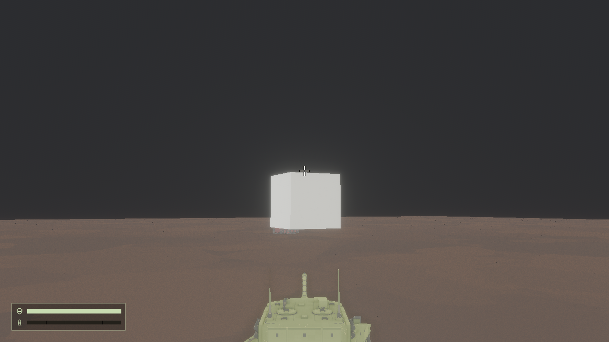
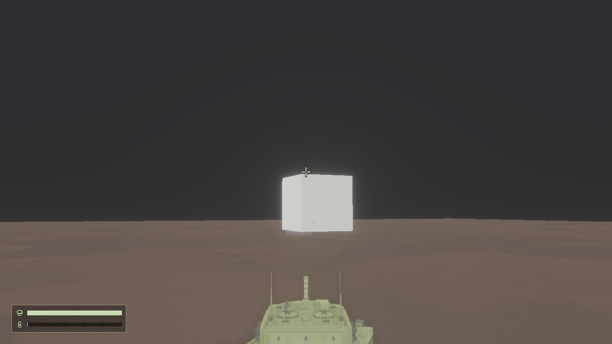
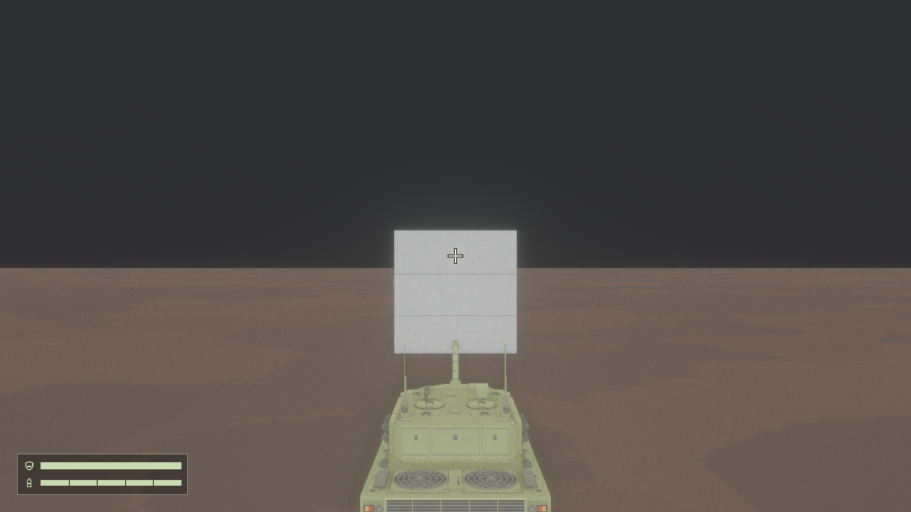

# 瞄准重做 04：组合验证记录

2026-11-03，在 Linux、AMD Radeon 780M / RADV / Vulkan、1280×720、固定 1/60 秒步长运行。实现的设计原则见 [瞄准意图](../intent/aiming.md)；用户手感和画面认可仍待确认。

本次 `integrated` 在真实地形上同时驾驶、转向、双轴瞄准并开火，比较前一帧与当帧炮口方向和弹丸方向；发射后放入可见测试障碍，通过实际首碰事件检查障碍。装填中验证直接反向、单轴释放及点按；真实退出和重进后检查对局实体、十字、视角以及首次输入和释放。无主动瞄准时，先让炮口稳定会聚已知平面，再驾驶转向：第 170 帧独立比较当前交点、旧交点及冻结相对炮塔姿态，停车后再次检查新交点会聚。此对照覆盖一条驾驶轨迹及其第 170 帧，不代表所有地形条件。

`integrated`、`aiming`、`articulation`、`combat`、`detail`、`drive` 均退出 0，报告通过；`detail` 有意测试缺失资源，日志中的该资源错误为预期。`aiming` 覆盖近远表面、敌人与障碍先后、目标删除、地面、围墙、无交点、俯仰上限及实际遮挡首碰；UI 检查覆盖 640×720、1280×720、1920×720、0.5 UI 缩放及模拟 1.5 显示缩放。`articulation` 覆盖模拟失焦、输入锁定、回绕及不同步长；`combat` 覆盖击中、爆炸和清理。报告及完整截图保存在本机 `.scratch/offscreen/aiming-rework-04-hardware-*`；已读取组合、重进、地面会聚、遮挡、上限、缩放、微调、松键、驾驶、详情及爆炸关键帧。

[组合报告](../references/aiming-rework-04-2026-11-03/report.txt)。测试平面初次过小、随后停车阶段错误地跨 360 帧比较角速度的失败分别保留在本机 `integrated-v7`、`v8` 和 `v9`；最终 `v14` 扩大平面并逐帧检查限速。

本次验证所用调校值：输入速度线性加速，0.15 秒达到最高值；水平 30°/秒、俯仰 9°/秒、范围 −9°～+20°；无交点使用 2000 米参照。上述数值及加速时间是实现参数，不表示用户已确认手感。组合限速容差为每帧 1e-5 弧度，发射方向容差为 1e-4，独立平面会聚容差为 0.15 米，十字中心容差为 2 逻辑像素。真实窗口焦点、键鼠手感及其他 GPU / 操作系统未验证。
