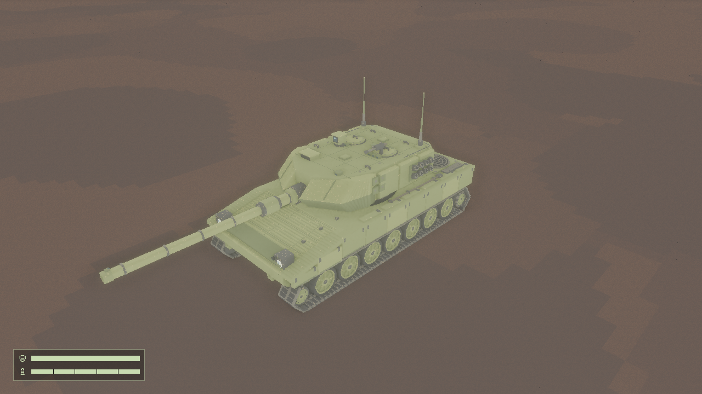

# astraH 玩家整车运动接入

- 日期：2026-11-01
- 设计依据：[模型意图](../intent/tank-model.md)、[ADR-0006](../adr/0006-whole-tank-motion-assembly.md)、[美术基线 v1](../art-direction.md)。
- 用户决定：采用 [astraH](../../tank_model/leovox_astraH/README.md)，保留外观；暂不设计瞄准操作，先以可设置角度与真实离屏验证完成运动链路。
- 美术状态：原始模型预览与新集成版本分别看待；用户尚未确认新集成的动态美术验收。

## 覆盖范围

原始 VOX 保留，转换为游戏所需的活动分组；默认姿态检查带颜色体素几何，非初始履带相位为运动派生。实际运行需覆盖车体驾驶、炮塔附件跟随、炮管俯仰、炮口世界姿态、独立弹丸及左右履带/轮组差速。画廊与详情展示同一套新整车，沿用原界面操作。

现有方向键和空格保持，正常游玩炮塔与炮管默认朝前水平。没有自动瞄准、坡地驾驶或部件换装；离屏将目标置于不同高度只用于证明炮管姿态和射击链路，不改变正式地图。

## 验证结果

已完成的验证：

- `cargo check --offline` 通过。完整 `cargo test --offline -- --test-threads=1`：主程序 111 项、两组生成器 5+4 项，共 120 项通过。首次全量回归发现碰撞测试仍使用旧车尺寸，更新为新契约的独立期望值后全量通过，未降低断言。
- Python 全套最终 56 项通过（包含发布失败回滚及旧敌方生成器格式兼容回归）；资源转换 `python3 scripts/prepare_astra.py --check` 重生成一致。默认姿态 34 个分组、5,205,391 个有色体素的位置和颜色逐组完全保留，调色板一致。
- 真实资源测试覆盖实际装配尺寸、调色板、角度、发射、清理；另验证抬炮/俯炮的高低目标扫掠命中、左右轮组独立运动与预览生命周期。
- `articulation` 硬件离屏通过：AMD Radeon 780M / RADV / Vulkan，1280×720；连续三帧分别设置 `(yaw,pitch)=(90°,20°)、(-90°,-5°)、(45°,0°)` 开火，验证三发弹丸独立存在、各自保持出生方向和外观朝向。场景仅为测试重置射击冷却，正常游戏仍每 5 秒一发。
- 已读取默认游戏画面和正负转角关节近景：炮塔附件共同跟转，炮管根部未见明显脱节。游戏沿用原有全局环境光与环境贴图，因此与原模型独立预览的方向光/SSAO视觉存在差异；本次没有改游戏灯光或调色板。

硬件回归均退出 0，报告中的设备均为同一 Radeon 780M / Vulkan：

| 场景 | 结果与检查 |
| --- | --- |
| [articulation](astra-player-2026-11-01/articulation-report.txt) | 三种偏航/俯仰与三发独立弹丸通过，读取默认帧和关节近景 |
| [drive](astra-player-2026-11-01/drive-report.txt) | 直行、转向、左右里程通过，读取转向结束帧 |
| [combat](astra-player-2026-11-01/combat-report.txt) | 开火、命中、单目标销毁与爆炸/弹丸清理通过，读取命中爆炸帧 |
| [wheels](astra-player-2026-11-01/wheels-report.txt) | 前进、倒车、两方向原地转向和停车通过；读取侧面帧 0/5/60/90 与斜前方整车图 |
| [gallery](astra-player-2026-11-01/gallery-report.txt) | 预览、返回、重复清理通过；读取画廊卡片 |
| [detail](astra-player-2026-11-01/detail-report.txt) | 九项资源、旋转/缩放/返回、错误项与实例清理通过；读取玩家部件和整车详情 |

已检查关键帧的模型轮廓、炮塔附件跟随、轮组显示与相位变化，未见明显丢件或关节脱节。该结论仅覆盖上述姿态和运动片段，不宣称所有炮塔角度均无机械穿插。技术验收通过，动态美术仍待用户确认。



[偏航90°、仰20°关节近景](astra-player-2026-11-01/yaw90-pitch20.png) · [偏航-90°、俯5°近景](astra-player-2026-11-01/yaw-minus90-pitch-minus5.png) · [轮组运动](astra-player-2026-11-01/wheels-moving.png) · [整车详情](astra-player-2026-11-01/detail.png)

## 代码审查

固定基线为本次开始的 `9ad972d`。Standards 轴发现 1 项：转换器直接覆盖配对资产，现已改为同卷临时文件、已有配对失败恢复及首次安装失败清理，并通过失败注入测试与复核。Spec 轴 0 项；未发现超出已确认范围的行为。四个资源文件不提供整套事务，与既有逐 VOX/meta 配对发布边界一致。

复现命令（输出目录已存在时需换新路径）：

```sh
python3 scripts/prepare_astra.py --check
python3 -m unittest discover -s scripts -p 'test_*.py'
cargo check --offline
cargo test --offline -- --test-threads=1
cargo run --offline -- --offscreen-test articulation --output .scratch/astra-player/evidence/articulation-new
cargo run --offline -- --offscreen-test wheels --output .scratch/astra-player/evidence/wheels-new
cargo run --offline -- --offscreen-test drive --output .scratch/astra-player/evidence/drive-new
cargo run --offline -- --offscreen-test combat --output .scratch/astra-player/evidence/combat-new
cargo run --offline -- --offscreen-test gallery --output .scratch/astra-player/evidence/gallery-new
cargo run --offline -- --offscreen-test detail --output .scratch/astra-player/evidence/detail-new
```

沙箱内没有 `/dev/dri`，按[GPU 排查](gpu-diagnostics.md)在获准的宿主机执行后台离屏，未启动可见窗口。

Python 全量首次复跑发现旧敌方生成器只接受单行整数尺寸字面量；共享 `WheelSpec.size` 改为浮点、经格式化换行后解析失败。修复为跨行解析、精确正整数尺寸检查，拒绝静默截断；敌方三包重生成逐字节一致，最终全量通过。

## 已知边界

沿用简化车体碰撞，炮管与细小附件不单独碰撞。炮塔旋转不构成对所有障碍环境下机械干涉的通用约束解算。原模型是静态外观，活动关节需要实际引擎关键帧验收，不能沿用旧 anvil/lance/cleat 的美术结论。

履带相位边界：原作者各段板距略有不同，三相位按约 14 cm 板距循环，非连续逐板机构模拟；保留相位 0 外观，其他相位沿原六段闭环搬移并按 2 cm 体素格重新量化，存在离散跳变。需要连续履带时再改为逐板路径实例。

其他检查：三个新增 Rust 文件的定向 `rustfmt --check` 通过。全仓 `cargo fmt --check` 仍报告既有文件的格式差异（如基线已有的 `src/app/chrome.rs`），未做无关全仓格式改动；`git diff --check` 通过。

实现提交：`2995589`（转换与资源）、`a92b22e`（运行时与离屏）、`5cfcdab`（配对发布回滚）、`e401dfe`（新碰撞契约回归）、`b5bed23`（旧敌方生成器格式兼容）。原始 astraH VOX 与作者源均未修改。
