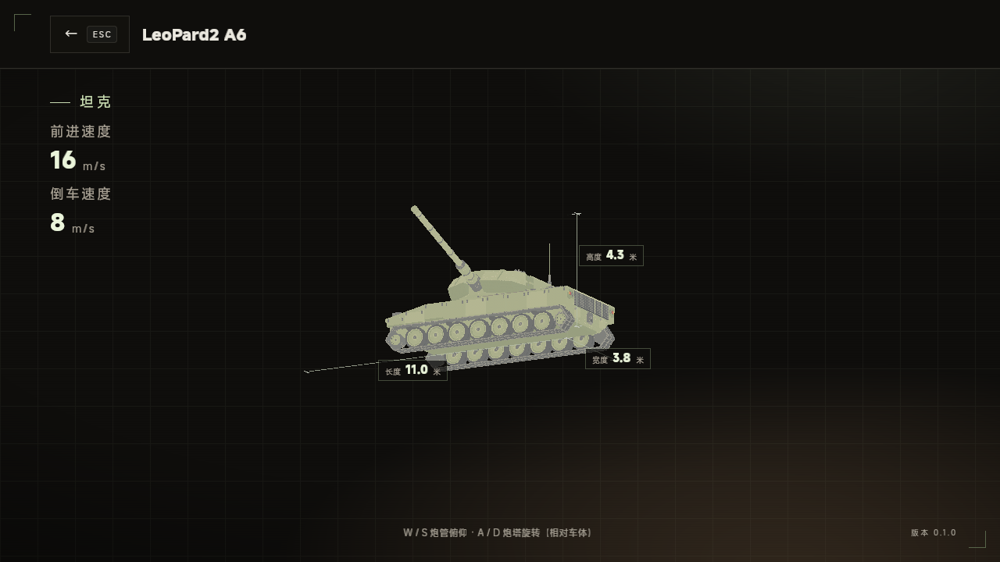
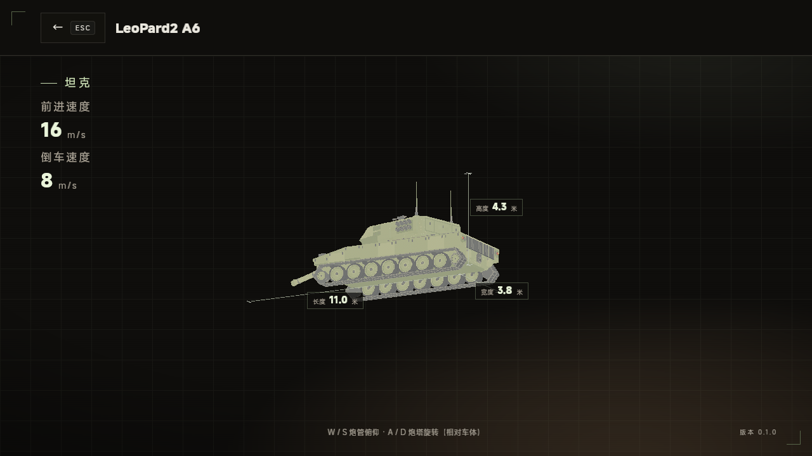
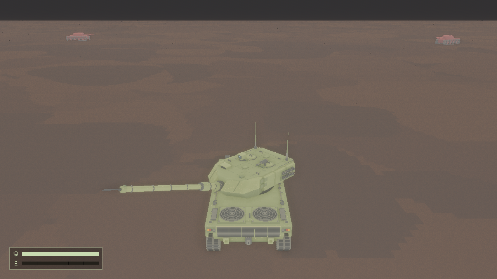

# 豹 2A6 炮塔控制技术验收

日期：2026-11-02。范围为 WASD 控制与炮口世界姿态发射，不重新制作模型，不代表用户已确认动态美术效果。

## 行为与配置

- W/S 炮管上仰/下俯，A/D 炮塔左/右转；方向键驾驶、空格开炮。支持同时操作、反向抵消、松键停止。
- 炮塔角度相对车体保持，随车体转向；相机继续跟随车尾。没有世界方向稳定器或瞄准镜。
- 豹 2A6 详情复用配置与角度积分，独立拥有角度；每次进入复位，退出不带入对局。敌车/弹丸详情和画廊卡片不响应 WASD。
- 详情保留鼠标整车旋转和缩放，底部显示快捷键提示；尺寸轴与数字保持默认姿态的静态测量。失焦与过渡停止调炮。
- 配置在 `assets/tank/player/leopard2_a6/tank.jsonc`，启动时读取并校验；缺失/非法的玩家运动配置阻止启动，无数值兜底。

[参数来源与限制](../references/leopard-2a6-articulation.md)：俯仰公开范围 −9°～+20°、炮塔全周。水平30°/秒和俯仰9°/秒为临时游戏采用值，A6 专属实车精确速度尚未核实；不以其他游戏数据作实车依据。全方位共用俯仰范围，未模拟车尾防碰撞联锁。

## 自动验证

- `cargo check` 通过。
- `cargo test`：124 项单元测试、5 项单位配置集成测试、4 项 VOX 细分集成测试，共133项通过，无失败或忽略。新增控制速度/限位/帧率、WASD抵消/松键/玩家隔离/失焦/过渡、非法配置覆盖；保留原炮口、俯仰命中、独立多发弹丸测试。
- 无窗口离屏四项均退出0，均在 NVIDIA GeForce RTX 4060 / Vulkan 硬件渲染；1280×720，种子42，1/60秒。原始产物在 `.scratch/turret-control/<场景>-01/`；下列报告与关键帧纳入 Git。

| 场景 | 关键覆盖 | 报告 |
| --- | --- | --- |
| articulation | 前三帧独立多发；WASD双轴、车体转90°后相对偏航、20°/−9°限位、松键停止、转向后的发射方向 | [报告](leopard-2a6-articulation/articulation-report.txt) |
| detail | 真实WASD、仅豹2A6、上下限/回绕/松键；鼠标拖拽与缩放；640/1280/1920宽布局；重新进入复位；退出后进入真实对局不继承角度；故障返回和资源回收 | [报告](leopard-2a6-articulation/detail-report.txt) |
| drive | 真实地形的直行、转向及履带回归 | [报告](leopard-2a6-articulation/drive-report.txt) |
| combat | 炮口出生、命中、爆炸及清理回归 | [报告](leopard-2a6-articulation/combat-report.txt) |

注：details 的提示尺寸和按键文案在初次离屏后归入 UI 资源常量，数值与最终可见字符串保持一致；随后 `cargo check` 再次通过。

## 画面读取

已读取对局210/211/420、驾驶180、战斗6帧，以及详情左右俯仰、窄屏布局。观察到炮塔附件随转、炮管上仰/下俯、车体朝向独立、弹丸从转动后的炮口发出；详情操作提示与参数/模型没有重叠。尺寸仍描述默认静态车型，不表示活动后包围盒。

## 评审与限制

基于 b670f7b 的本次差异进行了 Standards/Spec 两轴独立评审。Spec 未发现行为缺陷；Standards 提出的提示尺寸/键帽文案资源归档问题已修复。未改写现有炮口发射链路，未新增依赖。

仅验证本机 Windows / RTX 4060 / Vulkan，没有可见窗口真实键鼠、Linux或其它GPU验证；不从离屏平均更新时间推断游戏FPS。运行日志出现 ICU4X 中文分词模型警告，图片中的中文已正常渲染，未引起场景失败。实车A6专属角速度及方位相关限位仍待更可靠公开资料，当前值不可标作精确复刻。
