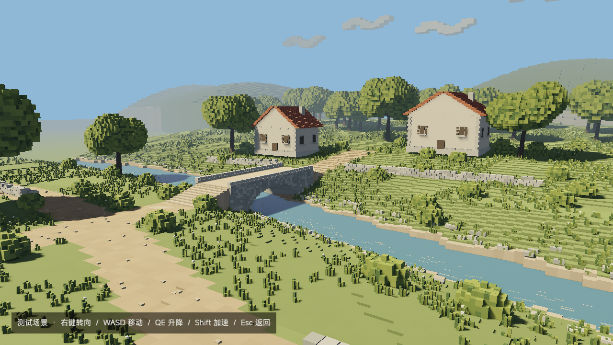
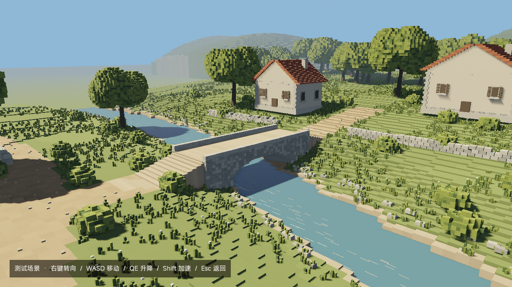
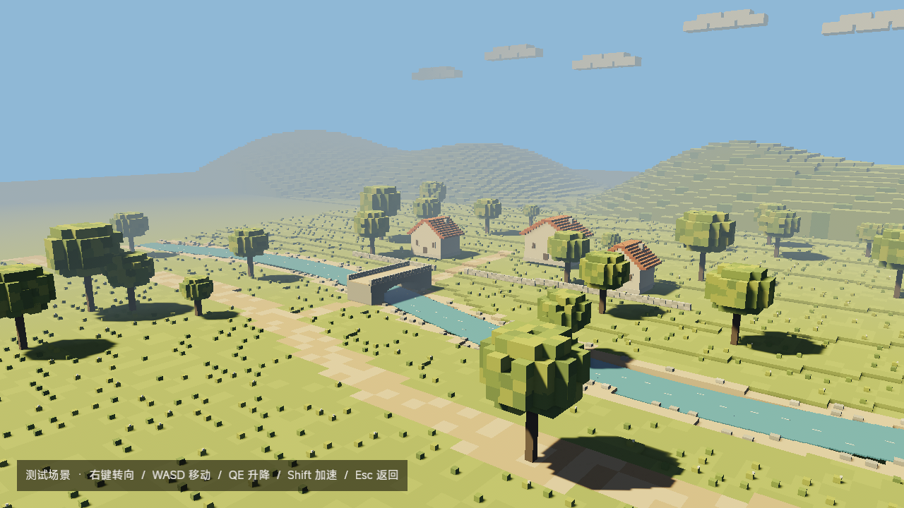
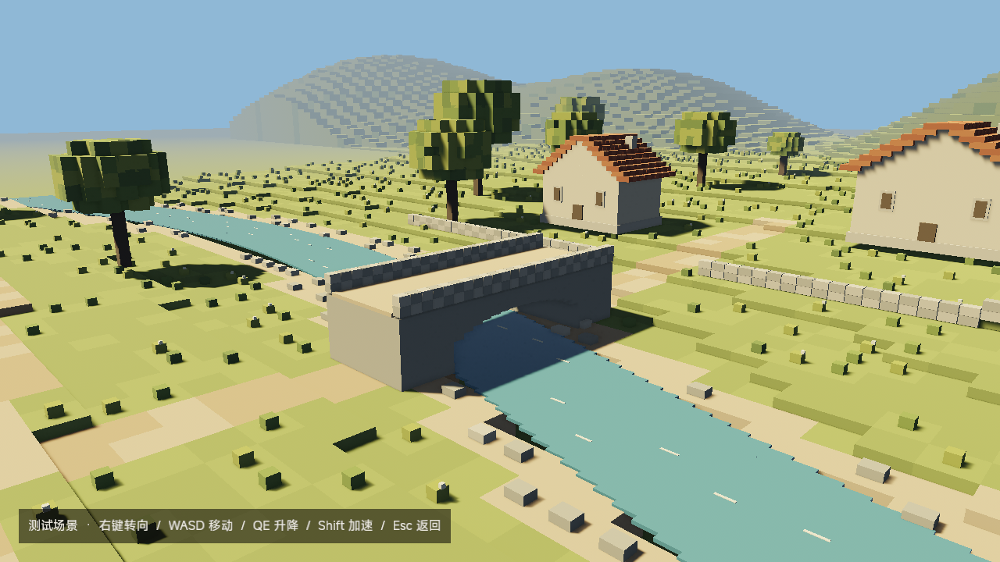

# 田园测试场景：视觉样板与修订记录

## 当前版本：近景细化（2026-10-31）

用户指出首版与参考图差距过大；首版仅作为历史试作保留，不能视为美术验收。按用户确认的修正方向，将细节集中到约 90×100 米的桥边近景，主体收敛为一座石桥、两栋农舍与前景植被，外围保留简化背景。

- 进入机位由远距离俯视改为靠近河岸的观察角度，移开遮挡农舍的树冠。
- 地面改用 0.75 米水平采样、0.12 米高度阶梯；草簇使用确定性非栅格位置，增加灌木、白花和河岸碎石。
- 树冠由多个细叶椭球簇构成，补分枝；远处林带使用较粗叶块控制渲染成本。
- 农舍细化屋瓦、墙角石、墙脚、窗台与侧窗；石桥补细石立面及两端接地缓坡，石墙错缝并形成不齐的压顶。
- 采用相机 Gaussian 阴影过滤，调整太阳色温与环境补光；水面保持连续色调，材质内仅保留适量明度变化。




验证：`cargo check`、`cargo test pages::pastoral::tests -- --test-threads=1`（2 项）通过。`cargo run -- --offscreen-test pastoral --output .scratch/pastoral-preview-20261031/refined-3` 退出 0，AMD Radeon 780M / Vulkan；菜单进入、飞行、两次往返与资源清理通过，实际读取全景和桥边关键帧。保留[离屏报告](refined-report.txt)。平均模拟更新墙钟约 24.79 ms，包含同步渲染等开销，不等于正常窗口帧率承诺。

美术状态：修正版待用户确认。相对参考图仍缺少精细建筑造型、复杂水面反射、自然天空及更丰富的间接光；不能宣称达到参考图质量。本轮只改布景和页面相机光照，未重跑首版已有失败的全量资源测试和原对局回归；其未解决状态见下方历史记录。

## 首版历史记录


- 日期：2026-10-31；美术基线 v1。
- 主要参考：[01-pastoral.png](../../references/art-directions/2026-10-30/01-pastoral.png)。保留参考的田园题材、暖阳、冷色暗部、红瓦农舍、石桥与植被空间关系，简化对象数量与细节；没有复制参考图中的坦克。
- 实现入口：首页第三项“测试场景”。主要布景约 200×200 米，外围地色与山丘用于衔接远景；世界单位为米。
- 独立页面：不生成玩家、敌人、武器、战斗 HUD 或物理碰撞。右键转向，WASD 移动，QE 升降，Shift 加速，Esc 返回第三项；失焦与过渡锁阻止相机输入。
- 配套：暖色方向光与阴影、相机独立冷色环境补光、SSAO、天空背景和体素云、距离雾、Blender Filmic 色调映射。全局环境光保持不变。
- 几何为确定性程序布景，固定色盘分为 15 个网格批次；没有新增依赖或修改原对局地形和坦克资源。

## 真实引擎画面





首轮截图发现屋脊未封口和远山像直立墙，已修正为封闭山墙与阶梯坡地，以上均为修正后的 v2 截图。

## 技术验证

```text
cargo run -- --offscreen-test pastoral --output .scratch/pastoral-preview-20261031/v2
```

退出码 0，报告“通过”。实际设备为 AMD Radeon 780M Graphics (RADV PHOENIX)，后端 Vulkan；1280×720、种子 42、模拟步长 1/60 秒。检查全景、石桥、飞行后画面与首页截图；未启动可见窗口。

断言覆盖真实首页第三项键盘进入、无玩家/敌人/战斗 HUD、几何批次与唯一相机就绪、W 前进、两次进入与退出、实体/太阳清理、共享环境光不变和返回焦点。其余相机输入门控由单元测试覆盖。原始报告与其余帧保留在上述本地目录，不作为游戏依赖。

补充检查：`cargo check`、`cargo build` 通过；新增菜单命中、自由相机输入门控与几何测试通过，两个资产集成测试文件共 9 项通过。
完整 `cargo test -- --test-threads=1` 在宿主机结果为 108 通过、2 失败：`real_previews_measure_visible_geometry_and_clean_instances` 的缺失资产失败回报等待超时，`real_tracks_remain_visible_when_moving_turning_and_stopping` 的缺失轮节点失败回报等待超时。沙箱中同两项还出现过正常资源加载超时；本次未改动这两项测试或放宽时限，不能宣称完整测试通过。日志保留在 `/tmp/tanker-pastoral-tests-final.log`，不以其作为长期证据唯一来源。
额外 `--offscreen-test index --output .scratch/pastoral-preview-20261031/index-regression` 在原对局交接等待阶段超过 180 秒，退出码 1，报告“强制结束；结果：失败”。首页第三项、三项 hover 与多个分辨率布局已输出，但不能宣称首页到原对局的完整回归通过；未降低断言或修改原对局加载逻辑。

网页过渡测试尝试因缺少 Playwright 模块未运行；网页仅同步第三项视觉占位，游戏菜单已有实际离屏截图验证。

## 美术结论与边界

已实现首版样板，**待用户确认效果**，不代表整套美术风格已验收。相对参考图，植被较稀疏、体素颗粒更粗、建筑与河岸细节少、天空与水面简化，阴影偏硬；本版用于快速观察构图、配色、光照与远近层次。

无水流动画、植被摆动、反射或建筑内部。相机允许穿过物体；没有真实键鼠、焦点切换、显示缩放的窗口人工验收。离屏模拟性能不是实际游玩的帧率承诺。实现尚未提交，后续可通过 Git 历史定位本记录的落地提交。
