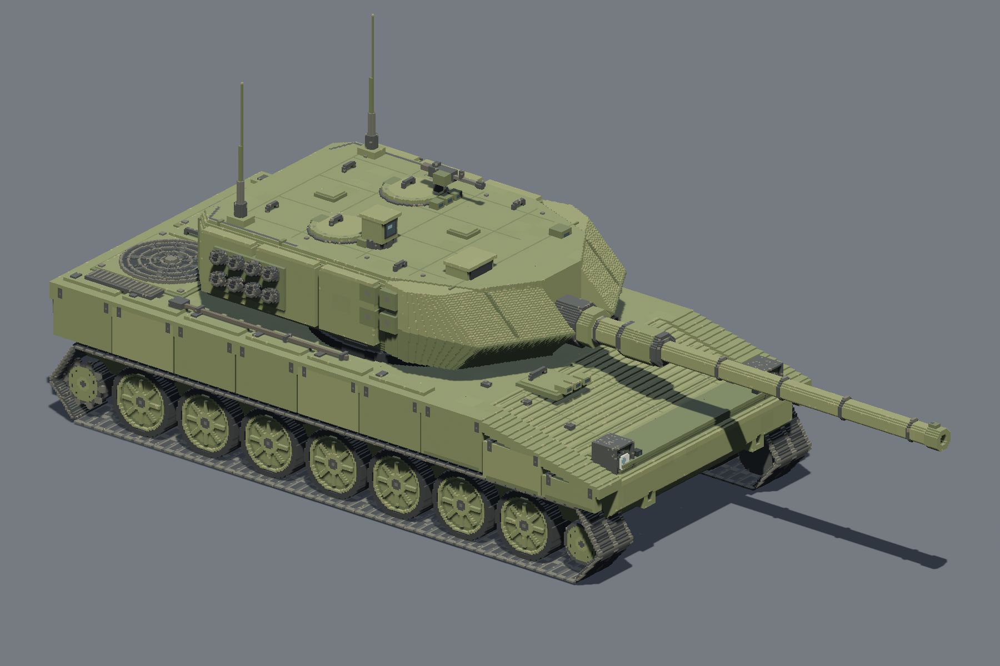
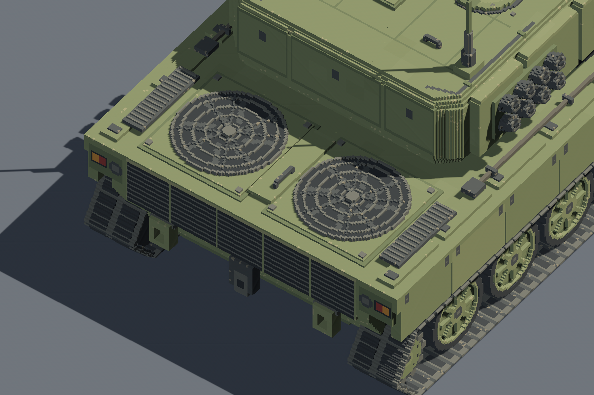

# Leopard 2A6 · astraH

2026-10-30 独立制作的完整外观 VOX。依据指定的 [v2 设计稿](../docs/references/leopard-2a6-style-v2-2026-10-30/README.md) 和[尺寸文档](../docs/leopard-a6-dimensions.md)，从空白体素场构建；没有读取、复制或改造项目内其他坦克模型。

**交付文件：[leopard_2a6.vox](leopard_2a6.vox)**。每格 **0.02 m**，5,205,391 个有色体素、34 个命名部件、42 个存储模型，文件 20,833,640 字节。完整场景存于同一个 VOX，长炮和天线没有截断或缩小。分块仅用于标准 XYZI 字节坐标编码，场景图将各块放回同一连续坐标空间。



## 尺寸与坐标

原点是车尾端面、车体中线与地面的交点；**+X 向车首，+Y 向车体自身左侧，+Z 向上**。所有体素边界落在 2 cm 网格。括号中的区间为左闭右开。

| 项目 | 本模型 | 说明 |
| --- | --- | --- |
| 车体长 | 7.66 m / 383 格 | X=[0,383)，不含炮管 |
| 炮向前全长 | 10.98 m / 549 格 | 10.97 m 按源文档量化，+1 cm |
| 标准宽 | 3.76 m / 188 格 | Y=[-94,94) |
| 甲板基准高 | 1.60 m / 80 格 | 甲板附件另计 |
| 炮塔主体屋顶 | 2.64 m / 132 格 | 螺栓、把手、观瞄另计 |
| 舱盖本体顶 | 2.70 m / 135 格 | 把手另计 |
| 炮轴 | 2.08 m / 104 格 | 炮管横截面以轴线对称采样 |
| 炮塔含楔甲长度 | 4.60 m / 230 格 | X=[76,306) |
| 炮塔主体宽 | 3.00 m / 150 格 | 不含侧面烟幕附件 |
| 负重轮直径、宽 | 0.80 × 0.40 m | 每侧七个，轮辋有实际凹入深度 |
| 端轮直径、宽 | 0.50 × 0.40 m | 后主动轮、前诱导轮 |
| 所有轮轴高度 | 0.42 m | 不将端轮抬高来迁就透视图 |
| 紧凑 PERI 顶 | 3.02 m | 设计稿比例估算，无实测依据 |
| 双天线顶 | 4.32 m | 设计稿比例估算，无实测依据 |

负重轮 X 中心为 58/103/147/192/236/281/325 格，中心间距按 0.89 m 目标量化为交替 44/45 格，避免把半格中心当作实际体素坐标。轮组保留源文档的七轮近似等距口径。

轮径 0.80 m、轴高 0.42 m 只给下方履带留下 0.02 m；因此平直底段采用尺寸文档允许的单格接触层。上段和端部有连续内带、分段金属板、双橡胶垫和导向凸齿。此处优先保证指定尺寸，不以覆盖轮胎底部来伪造轮径。

## 设计稿冲突取舍

| 内容 | 采用的参考与决定 |
| --- | --- |
| 整体轮廓、配色、楔形装甲 | 01 右前图为主；按米制目标调整透视图中的比例 |
| 车尾 | 02 正后图：五分区百叶、两端红/琥珀灯片及独立暗色圆灯、左右牵引环和中央拖钩 |
| 动力舱 | 04 俯视图：两只并排圆形主风扇，实际分层叶片、同心环网和径向辐条；不采用 06/07 的矩形主风扇 |
| 前灯 | 01/03 的圆灯与保护架；舍弃 05 的大方灯 |
| 车顶 | 面向车首，右侧车长、左侧装填手与机枪；紧凑偏置 PERI，两个低矮舱盖，固定朝前的光学窗口 |
| 烟幕与天线 | 每侧两排各四筒，共 16 筒；炮塔后部双天线，所有角度均来自同一套三维挂点 |
| 炮塔尾 | 三只储物箱；不采用 06 的炮塔尾发动机式格栅 |
| 轮组 | 每侧七个负重轮；后齿状主动轮、前诱导轮，纠正源文档旧段落中与 +X 向前相反的标签 |
| 05/06/07 冲突细节 | 不用它们覆盖上述统一规则；保留其提供的装配层次感，不混用互相冲突的附件 |

完整外观包括船形下车体、首上斜甲、分段侧裙与铰链、驾驶员舱盖、十四个负重轮、四个端轮、悬挂与托带轮、双侧闭环履带、座圈、双侧复合楔甲、炮塔侧板和尾储物箱、L55 防盾/护套/抽烟器/卡箍/空心炮口、观瞄、机枪、双天线、烟幕筒、双圆风扇、百叶、灯具、扶手、工具杆、牵引索及牵引件。面板凹缝、轮辋、格栅网罩均由实际体素几何表达。材质采用克制橄榄绿、深色橡胶/钢件、少量边缘磨损与光学色块。

## 文件与使用

| 文件 | 用途 |
| --- | --- |
| `leopard_2a6.vox` | 完整静态场景，标准 VOX 150 / RGBA / 场景图 |
| `leopard_2a6.vox.meta` | Bevy 加载配置，明确每格 0.02 m |
| `build.py` | 独立作者化脚本，依赖 NumPy；会重建本目录模型与清单 |
| `verify.py` | 从实际 VOX 重新解析与检查，依赖 NumPy / SciPy |
| `manifest.json` | 部件清单、逐部件体素边界、数量、文件 SHA-256 |
| `validation.json` | 文件结构、尺寸和关键几何断言的通过记录 |
| `Cargo.toml` / `Cargo.lock` | 独立预览包配置，不依赖工程根包的预览入口 |
| `preview.rs` | 直接加载交付 VOX 的 Bevy 0.20 无窗口预览 |
| `renders/` | 十张 1800×1200 实际引擎截图及 `report.txt` |

从工程根目录执行：

```powershell
python leovox_astraH/build.py
python leovox_astraH/verify.py
cargo check --manifest-path leovox_astraH/Cargo.toml
cargo run --manifest-path leovox_astraH/Cargo.toml -- leovox_astraH/renders-new
```

预览拒绝覆盖已存在的 PNG，复测需使用新目录。没有启动可见窗口。

加载完整场景时，将 `.vox` 与 `.vox.meta` 放在同一资产目录，用 `WorldAssetRoot(assets.load("leopard_2a6.vox"))` 加载；不要只取 `#model0`。其他引擎须遍历完整场景图并设置每格 0.02 m。VOX 本身没有通用米制单位，Bevy 的 `.meta` 与本清单负责明确比例。Bevy 插件将作者坐标转换为 `(-X, Z, Y)`。

34 个命名分组用于辨认装配；它们当前共享作者原点。模型交付为闭舱静态外观，没有乘员舱/发动机内构、骨骼或驾驶动画，也没有游戏碰撞与控制逻辑。

## 验证与画面

文件回读验证通过：块长度、节点顺序、场景引用、局部与全局坐标、非重叠装配、颜色索引、SHA-256、整车与部件尺寸、轮组数量、轮轴、炮口空腔、风扇网罩空隙、烟幕挂点；六邻接连通体只有一个，无悬空碎块。完整结果见 [validation.json](validation.json)。

实际引擎验证：**NVIDIA GeForce RTX 4060 / Vulkan，42 个网格**；从加载后的网格顶点计算得到 Bevy XYZ 包络 **10.98 × 4.32 × 3.76 m**。十张图均保存成功，进程退出码 0，见[渲染报告](renders/report.txt)。

已读取实际截图检查整车轮廓、双侧轮组、楔形炮塔、炮管、灯具、两只圆风扇和车顶附件。实际预览采用正交相机、固定灯光与 SSAO；与概念图的摄影透视、柔光、表面做旧仍有表现差异，**不宣称逐像素还原或用户已完成美术验收**。

| 整车视角 | 细节与补充视角 |
| --- | --- |
| [01 右前](renders/01-front-right.png) | [06 左后](renders/06-rear-left.png) |
| [02 正后](renders/02-rear.png) | [07 右后](renders/07-rear-right.png) |
| [03 正前](renders/03-front.png) | [08 右侧正交](renders/08-right-side.png) |
| [04 垂直俯视](renders/04-top.png) | [09 动力舱近景](renders/09-engine-detail.png) |
| [05 左前](renders/05-front-left.png) | [10 炮塔近景](renders/10-turret-detail.png) |



模型、说明和独立预览配置均保存在本文件夹；工程根配置与文档没有本次建模追加内容。未进行多车性能、Linux、其他 GPU 或动画集成验证。完整实心体素数据约 20.8 MB，若后续大规模实例化，需另行测量加载与渲染开销。
