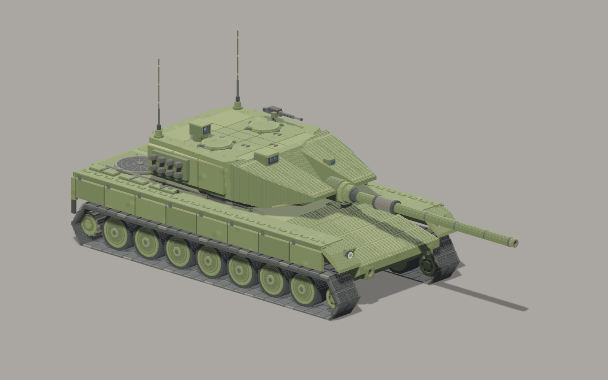

# Leopard 2A6 · solH 独立厘米体素模型

2026-10-30。按用户指定的[七视角概念图](../docs/references/leopard-2a6-style-v2-2026-10-30/README.md)和[尺寸表](../docs/leopard-a6-dimensions.md)从零构建外观模型。遵循[精细体素半写实基线](../docs/art-direction.md)。未读取或复用其他坦克模型几何，没有替换游戏当前玩家资源。

**交付文件：[leopard_2a6.vox](leopard_2a6.vox)**。配套的 [leopard_2a6.vox.meta](leopard_2a6.vox.meta) 将 Bevy `bevy_vox_scene` 的每格尺寸设为 **0.01 米**。VOX 格式本身不存米制单位，加载时应保留此设置，不再额外缩放 0.01。

## 文件

| 文件 | 用途 |
| --- | --- |
| `leopard_2a6.vox` / `.vox.meta` | 完整整车及厘米加载设置 |
| `build.py` | 独立、确定性的几何作者化与标准 VOX 场景导出；依赖 NumPy、SciPy |
| `test_model.py` | 独立解析实际 VOX，检查尺寸、跨块拼接、轮组、炮膛及灯组 |
| `model_report.json` | 当前文件 SHA-256、实际体素数、23 个机械部件、叶块数和厘米边界 |
| `Cargo.toml` / `Cargo.lock` | 独立预览包配置，所有配置保存在模型文件夹内 |
| `preview.rs` | 真实 Bevy 0.20 / bevy_vox_scene 0.23 无窗口加载及渲染 |
| `renders-final/` | 同一个 VOX 的七视角、车顶细节和右侧正投影；报告记录 GPU、真实网格尺寸与退出结果 |
| `renders-v1/`～`renders-v4/` | 迭代过程证据；最终模型以 `renders-final/` 为准 |

## 尺寸与原点

整数坐标均为厘米；区间上界不包含。**VOX +X 为车前，+Y 为车辆左侧，+Z 为上**；车尾右侧地面为 `(0,0,0)`，纵向中线 Y=188，车体中点 X=383。Bevy 加载器转换为 `(-X,Z,Y)`。

| 项目 | 本交付 | 口径 |
| --- | ---: | --- |
| 车体长 | 766 格 / 7.66 m | 车尾至车首，不含长炮管 |
| 炮向前全长 | 1097 格 / 10.97 m | 车尾至炮口；使用原米制目标，不沿用旧 2 cm 网格的 10.98 m 取整 |
| 总宽 | 376 格 / 3.76 m | 左右履带、裙板外沿 |
| 主甲板高 | 160 格 / 1.60 m | 不含检修盖、风扇罩与工具 |
| 炮塔主体顶高 | 264 格 / 2.64 m | 不含附件 |
| 舱盖顶高 | 270 格 / 2.70 m | 两个闭合舱盖 |
| 炮轴高 | 208 格 / 2.08 m | 水平前指；120 mm 孔径对应 12 格 |
| 炮塔含前楔长 / 主体宽 | 460 / 300 格 | X=152～612；300 格不包含外侧烟幕筒 |
| 负重轮直径 / 胎体宽 | 80 / 40 格 | 轮毂、螺栓另外外凸 |
| 端轮直径 / 胎体宽 | 50 / 40 格 | 前诱导轮、后齿状主动轮 |
| 轮轴高 | 42 格 / 0.42 m | 负重轮下缘 2 格，与下履带接合 |
| 履带包络高 | 96 格 / 0.96 m | 每侧 56 块履带板、双橡胶垫与金属连接端 |
| PERI 顶高 | 303 格 / 3.03 m | 根据概念图估算的紧凑观瞄；不宣称它就是来源中未明确的装备高度端点 |
| 含天线总高 | 438 格 / 4.38 m | 按概念图比例估算，不是实车测绘值 |

七轮中心 X=107/196/285/374/463/552/641，端轮 X=30/732。尺寸表端轮 X 标签与“+X 向前”相矛盾；本模型按同文档和设计稿的机械要求校正为 **X=30 后主动轮，X=732 前诱导轮**。轮距保留尺寸表的等距简化。左右轮胎体 Y=23～63 / 313～353。

原尺寸表把观瞄、机枪和天线都裁到旧画布 2.70 m 高度内，那是旧交付的附件简化。本次按用户要求完整构建，保留 2.64 m 屋顶和 2.70 m 舱盖目标，单独补全附件高度。没有修改游戏碰撞或驾驶参数。

## 设计稿冲突的统一决定

1. **01 右前图**约束橄榄绿配色、长低车体、楔形装甲、大中小块面与外露轮组。装甲尺度服从尺寸表。
2. **02 正后图**决定尾灯、五分区横向百叶、双牵引环和中央牵引件。尾灯为外侧琥珀/红色横排透镜、内侧暗圆灯，灯光关闭；无白色方形尾灯。
3. **04 俯视图**决定两个并排主风扇、左右舱盖、炮塔后部双天线和车顶附件的空间布局。预览采用真正垂直正投影。
4. **03 正前图**只用于检查圆前灯、楔形炮塔和车长右侧布局；烟幕筒采用文字修订约束的每侧两排、每排四筒，不采纳图中增加的排数。
5. **05～07**包含目录已指出的结构回退，不用于反转上述决定；不采用中央巨型观瞄塔、方形前灯、多组矩形主风扇或炮塔尾发动机格栅。

保留：L55 长炮管、单抽烟器、分节隔热套、真实空心炮口；两舱盖、右侧 PERI 和前右 EMES、左侧前指 MG3；16 个烟幕筒、双天线；双圆风扇的同心和径向保护网；八段侧裙板、检修缝、工具箱、牵引索、螺栓与前灯保护架。表面色变化克制，灯、玻璃、橡胶、金属和装甲分别建色盘材质。

这是完整外观资产；未构建乘员舱、发动机内部和炮闩内部机构。隐蔽实心填充在导出时剔除，仅保留两格外壳与机械部件交界；不用于体积、质量或实车装甲厚度推导。

## VOX 组织与引擎加载

整车画布 **1097×376×438 格**，没有缩到 256 格，也没有降低 1 cm 作者精度。标准 `XYZI` 的局部坐标是字节，导出器将各机械部件无损放进多个 `SIZE/XYZI` 叶块，用 `nTRN/nGRP/nSHP` 还原唯一整车场景。各块采用偶数紧包围画布，避免半格 pivot 偏移。

23 个机械部件以名字前缀区分：`hull`、`turret`、`gun`、`track_right/left`、14 个 `roadwheel_*`、2 个 `idler_*`、2 个 `sprocket_*`。当前为静态整车姿态；分块的叶节点保持全局厘米位置，未来做关节运动需要整理父子节点及转轴。

把 `.vox` 和 `.vox.meta` 一起放入引擎资源目录后，使用项目已有 `VoxScenePlugin` 加载整个文件。摄影棚的平移 `Transform::from_xyz(3.83, 0.0, -1.88)` 仅把车体中点放在场景原点，不属于资源内容。

## 复现与验证

在工程根目录执行：

```powershell
python leovox_solH/build.py
python -m unittest discover -s leovox_solH -p test_model.py
cargo check --manifest-path leovox_solH/Cargo.toml
cargo run --manifest-path leovox_solH/Cargo.toml -- leovox_solH/renders-new
```

`build.py` 重建其专有的 `.vox` 和 JSON；预览输出路径必须尚不存在，拒绝覆盖旧帧。预览只加载本交付模型和中性摄影棚，不创建可见窗口，不依赖游戏其他模型。

独立 Python 回读检查覆盖：全局边界和无坐标回绕/重叠、部件数、七轮尺寸及轮位、履带高度、屋顶和舱盖高度、空心炮口、镜像尾灯与无白色尾灯。生成器还对几何原语进行断言自检。引擎额外检查全部叶块和 GPU 网格/纹理就绪、管线与资源错误、真实变换后 AABB、贴地、PNG 保存和退出码。

2026-10-30 技术检查：6 项 Python 回读检查、`cargo check`、`cargo check --example leovox_solh` 通过；真实 Bevy 离屏进程退出 0，九张 PNG 全部保存。交付物共 **4,076,033 体素、23 个机械部件、45 个叶块、16,314,006 字节**。实际加载网格量得长 10.969999、高 4.38、宽 3.7599998 m，最低点 0.0000 m；浮点误差在 0.1 mm 检查阈值内。文件校验和见 JSON，已独立重算核对。

技术结果见 [最终报告](renders-final/report.txt)。已人工读取全部九帧检查模型轮廓、轮数、附件归属、车尾与车顶结构及分块位置；效果属于本次实现对照，**用户美术验收待确认**。本次只验证 Windows / RTX 4060 / Vulkan，不外推 Linux 或其他显卡结果；没有验证履带动画、炮塔转动、游戏碰撞和运行性能预算。Cargo 的增量缓存硬链接警告使用复制回退，没有阻止检查和渲染。



工程隔离修正：已撤回本次建模向工程尺寸文档、车型目录和根 Cargo.toml 追加的内容。尺寸与设计取舍保留在本说明内；预览通过本目录独立 Cargo 清单运行。上述原有验证记录保留为历史证据。
