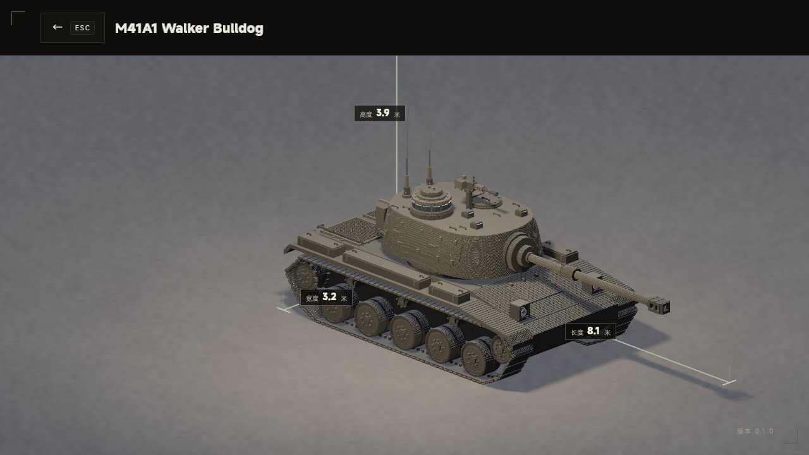

# M41A1 Walker Bulldog

根据 [2026-11-05 七视角设计稿](../../docs/references/m41a1-walker-bulldog-2026-11-05/README.md)制作的独立静态整车，1 cm/体素。参考 astraH 的作者化、命名分组、标准 VOX 分块、文件回读和实际引擎验收流程；基础几何、场景编码及解析器由其脚本改编，没有挪用豹式的车体或炮塔几何。

游戏入口：**首页 → 模型 → 坦克 → M41A1 Walker Bulldog**。支持详情页环绕、缩放和实际几何尺寸标注。车辆未编入对局，不借用豹 2A5 的战斗参数，也不提供 WASD 炮塔控制。

## 外观与取舍

以右前主图定义轮廓、深灰褐橄榄涂装和附件层次，以俯视图统一车长塔、双天线、机枪、储物箱及后甲板布局，以正后图统一尾灯和牵引件。全部角度来自同一个三维模型。

- 船形腹甲、倾斜首上、窄翼子板和分段工具箱，保留外露轮组，不增加现代侧裙。
- 每侧五个双排负重轮、前诱导轮、后齿状主动轮、三个托带轮；分节钢制履带、橡胶垫、内侧导向齿及连续内带。
- 逐层收分的圆角炮塔、曲面侧盖及扣件、座圈、尾储物箱、防盾、细长 76 mm 炮外观、抽烟器、双室制退器。炮口和两个侧窗是真实空腔。
- 右侧车长塔、十二个径向潜望窗、左侧圆舱盖、机枪、双天线；后甲板双矩形百叶与镂空网罩、前灯保护框、尾灯、牵引环、扶手与螺栓。
- 采用克制的局部色差与边缘磨损；两格厚外壳保留外表面并减少体素存储。内部没有乘员舱、发动机或装甲厚度模拟。

概念图中的局部形状有漂移：装填手舱盖采用右前图的圆形，未混用俯视图的椭圆；车长塔上帽、机枪及尾箱沿用概念概括，不宣称完成具体实车批次的零件测绘。轮径优先遵循归档尺寸，概念透视图中轮胎显得更大、更紧凑。网格轮廓、棚灯、做旧与概念图仍有差异，最终美术认可由用户评审。

## 尺寸与坐标

公开尺寸及其测量端点沿用[设计资料表](../../docs/references/m41a1-walker-bulldog-2026-11-05/README.md#建模尺寸参考)，不新增现实性能或游戏战斗数值。

| 项目 | 本模型采用值 | 依据与边界 |
| --- | --- | --- |
| 车体长度 | 5.82 m | 5.819 m 按 1 cm 四舍五入 |
| 炮向前全长 | 8.12 m | 8.123 m 按 1 cm 四舍五入 |
| 挡泥板外宽 | 3.20 m | 3.198 m 按 1 cm 四舍五入 |
| 腹甲离地 | 0.45 m | 0.445 m 取整 |
| 单侧履带名义宽 | 0.53 m | 斜面中心采样的边界向外占格，外包络 0.54 m |
| 负重轮直径 | 0.65 m | 0.648 m 取整；轮心位于半格，防止采样缩径 |
| 负重轮轴高 | 0.375 m | 为轮胎和下履带的可见接触关系采用的建模值，非测绘值 |
| 炮轴高度 | 1.91 m | 约 1.905 m 取整 |
| 甲板、炮塔主体顶 | 1.45 / 2.35 m | 概念图比例估算 |
| 车长塔上帽顶 | 2.80 m | 概念外形估算，扶手另计；不把博物馆口径不明的 2.71 m 当实测端点 |
| 机枪顶部 | 3.02 m | 3.018 m 取整 |
| 双天线顶部 | 3.90 m | 概念图比例估算；详情页整车高度包含天线 |

作者坐标为 +X 车首、+Y 左、+Z 上，设计尺寸均从车尾中心地面计量。导出时整体减去 `(291, 0, 145)` 格，使运行根原点位于车体纵向中心、甲板高度。插件转换为 Bevy `(-X, Z, Y)`；几何仍接地，页面按真实包围盒放置地面。

33 个命名装配组、56 个网格分块，2,681,059 个存储体素，VOX 约 10.7 MB（十进制）。通过 256 格局部分块存储，分块不改变 1 cm 尺度。根节点 `m41a1`；应加载完整场景，不要只加载 `#model0`。当前组共享静态根，没有运动轴或动画契约。

## 文件与复现

| 文件 | 用途 |
| --- | --- |
| `build.py` | NumPy 作者化脚本，生成本目录 VOX、meta 和 manifest |
| `verify.py` | NumPy / SciPy 独立文件回读与尺寸、轮组、履带及空腔检查 |
| `m41a1.vox` / `.meta` | 完整场景与 0.01 m 单位、材质加载设置 |
| `manifest.json` / `validation.json` | 命名部件、边界、体素数、SHA-256 和结构断言结果 |
| `renders/` | 真实游戏详情页八视角截图与离屏报告 |
| `../../assets/tank/display/m41a1/` | 游戏发布副本，与源 VOX/meta 字节一致 |

在已安装 NumPy / SciPy 的 Python 环境中，从工程根目录执行：

```bash
python3 tank_model/m41a1/build.py
python3 tank_model/m41a1/verify.py
cp tank_model/m41a1/m41a1.vox tank_model/m41a1/m41a1.vox.meta assets/tank/display/m41a1/
cargo check --offline
cargo test --offline --bin tanker pages:: -- --test-threads=1
cargo run --offline -- --offscreen-test detail --output .scratch/offscreen/m41a1-detail-new
cargo run --offline -- --offscreen-test gallery --output .scratch/offscreen/m41a1-gallery-new
```

先检查生成与验证退出码再复制资源；离屏输出目录不能已有同名产物。脚本重建覆盖本目录自身产物，运行资源需明确复制后才更新。

## 验证状态

2026-11-05，Linux / **AMD Radeon 780M Graphics（RADV PHOENIX）/ Vulkan**，Bevy 0.20.1、bevy_vox_scene 0.23.0。技术验证与用户美术认可分别记录。

- VOX 独立回读：32 项结构断言通过，包括块/节点完整性、无重叠装配、SHA-256、真实外包络、每侧五轮和三托带轮、轮径、履带接地和六邻接连续、轮顶间隙、双室制退器空腔及网罩开孔。
- `cargo check --offline` 通过；全量 Rust 测试 **161 个单元测试、9 个集成测试通过**，原有 1 个会播放声音的测试保持忽略。
- 根目录 Python 生成器测试 **42 项通过**；网页弹药自检与 `models.js` 语法检查通过。源与运行资源的 VOX/meta 字节相同。
- `detail` 预设通过：真实首页/画廊入口、四个模型、拖拽和缩放、规格归属、地面接触、尺寸测量、故障返回、页面和资源清理、对局状态隔离。见 [详情报告](renders/detail-report.txt)。
- `gallery` 预设通过：四个独立预览、三个坦克卡片、每项独立主光与渲染层、三个窗口尺寸、长型号换行与尺寸文字不重叠、键盘/鼠标导航及三次往返清理。见 [画廊报告](renders/gallery-report.txt)、[画廊截图](renders/gallery.png)。长名称向上换行，保留固定卡片尺寸与字号；回归脚本按实际目录数量循环至返回框。

已逐张读取以下真实详情页截图，检查整车轮廓、双侧五轮、上履带间隙、炮口、双格栅、侧盖、车长塔和双天线。正交镜头、固定棚灯与概念图的摄影柔光不同；左右受光差异、台阶边缘高光和做旧密度仍有差别。圆润部件为 1 cm 台阶概括，附件不是实车测绘级复制。**美术效果待用户确认，不以技术断言代替还原度认可。**

| 视角 | 实际截图 |
| --- | --- |
| 右前 | [01-front-right.png](renders/01-front-right.png) |
| 正后 | [02-rear.png](renders/02-rear.png) |
| 正前 | [03-front.png](renders/03-front.png) |
| 俯视（页面仰角上限 80°） | [04-top.png](renders/04-top.png) |
| 左前 | [05-front-left.png](renders/05-front-left.png) |
| 左后 | [06-rear-left.png](renders/06-rear-left.png) |
| 右后 | [07-rear-right.png](renders/07-rear-right.png) |
| 低机位右侧 | [08-right-side.png](renders/08-right-side.png) |



未进行可见窗口真实鼠标/焦点、跨显卡、动画与多车性能验证；当前交付为模型展示资产。三轮详情原始证据位于 `.scratch/offscreen/m41a1-detail-01`～`03`，长期截图保留最终 `03` 版本；画廊最终证据为 `.scratch/offscreen/m41a1-gallery-02`。
